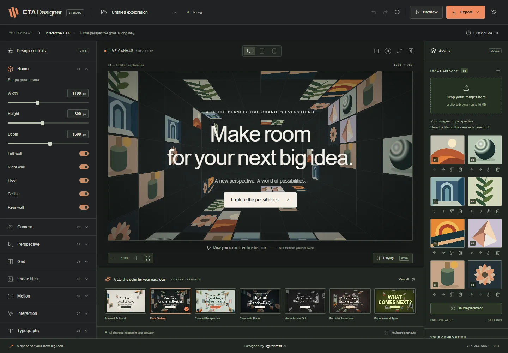
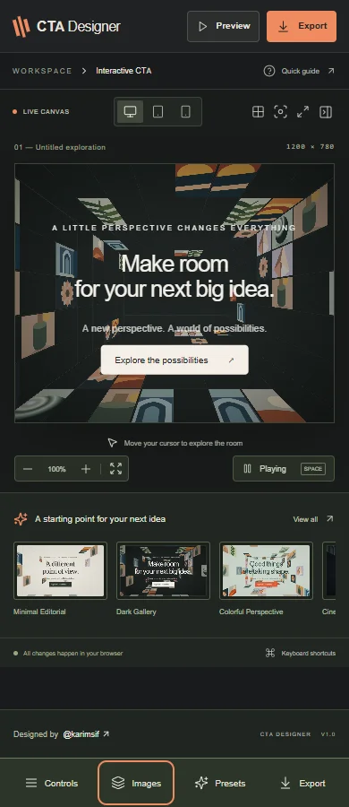

# CTA Designer

### A new perspective on the call to action.

[](https://github.com/karimsaif0/CTA-Designer-Web-App/actions/workflows/ci.yml)
[](LICENSE)

**[GitHub repository](https://github.com/karimsaif0/CTA-Designer-Web-App)** · **[Report an issue](https://github.com/karimsaif0/CTA-Designer-Web-App/issues)**

Live demo: production deployment pending.




A local-first creative workspace for designing interactive perspective-room call-to-action sections. Created by **Karim Saif**. The application footer links **Designed by @karimsif** to https://x.com/karimsaif0. Exported compositions contain no editor credit or interface chrome.

## Features

- **Shape the room:** dimensions, depth, surface visibility, camera, field of view, perspective and vanishing point.
- **Curate your images:** uploads, thumbnails, crop/scale/color adjustments, seeded placement, tile assignment, shuffle, replace, reorder and remove.
- **Bring it to life:** smooth cursor parallax, return to center, room drift, crossfades, easing, damping and global speed.
- **Make your statement:** editable headline, eyebrow, subtitle, typography, readable overlays and a fully styled, accessible CTA.
- **Start somewhere good:** seven polished presets plus persistent custom presets, imports, exports, renaming and duplication.
- **Keep exploring:** autosave, recent projects, undo/redo, desktop/tablet/mobile previews, zoom, fit and fullscreen.
- **Take the real component:** React project/component ZIP, self-contained HTML, full JSON and 2× PNG exports.

<details><summary>Mobile workspace</summary>



</details>

## Technology stack

| Area | Technology |
| --- | --- |
| Interface | React 19, strict TypeScript, Lucide, native modal dialogs |
| Rendering | CSS 3D, semantic HTML, ResizeObserver, requestAnimationFrame |
| State / validation | Zustand, Zod |
| Persistence | IndexedDB through idb, localStorage preferences |
| Export | JSZip, html-to-image, shared portable React runtime |
| Build / hosting | Vite, esbuild, npm lockfile, Vercel |
| Quality | Vitest, Playwright, axe-core, ESLint, GitHub Actions |

## Installation and local development

Requirements: Node.js 24, npm, and a modern browser with CSS 3D, ResizeObserver and IndexedDB support.

```sh
git clone https://github.com/karimsaif0/CTA-Designer-Web-App.git
cd CTA-Designer-Web-App
npm ci
npm run dev
```

Open the local URL printed by Vite. No environment variables, account, backend, API key or AI subscription are required. Assets and the font are bundled locally. The prepare step regenerates original artwork and builds the standalone runtime; it only needs the network for the font if the checked-in font is missing.

```sh
npm run typecheck
npm run lint
npm test
npm run build
npm run preview
```

## Design workflow

1. Start from one of seven curated presets, or use the default Dark Gallery composition.
2. Open the left control groups to edit room dimensions, surface visibility, camera, perspective, grid, image distribution, motion, pointer behavior, typography, CTA and appearance. Properties update immediately. A URL is committed on blur only when valid.
3. Upload PNG, JPEG or WebP files using the drop zone or file picker. Images are checked by MIME type and magic bytes, decoded, resized to a maximum 1600-pixel edge and re-encoded as WebP. The file limit is 10 MB, the decoded pixel limit is 64 megapixels, and the library is bounded to 60 assets / approximately 50 MB of encoded content. SVG uploads are intentionally unsupported.
4. Select an occupied tile in the room, then choose an image in the library to assign it to that surface cell. Assignments are preserved across automatic image shuffles. Change the seed or use Shuffle placement for a reproducible new distribution. Reorder, replace and remove images in the library. The rear wall stays clear in automatic all-surface placement; target `rear` explicitly to populate it.
5. Use viewport modes, zoom, fit, grid guides, reset camera, fullscreen and play/pause to inspect your work. Smaller screens use an overlay inspector and an image-library dialog. Click the application logo to access projects on mobile. Help also exposes editor settings.
6. Preview enables CTA navigation. In editing mode, clicking the CTA does not navigate.
7. Apply to project stores an explicit configuration snapshot in the active browser project. This is the standalone browser Apply mode. It does **not** write arbitrary local website files. No trusted local filesystem service or Toolcraft integration is installed or claimed.

Projects and custom presets persist in IndexedDB. The active project and lightweight display preferences use localStorage. Autosave runs 700 ms after the last edit; status and storage errors are visible. The history holds up to 60 edit groups; continuous adjustments within 450 ms are grouped. Undo history is session-only. Use JSON export for backups before clearing browser data or switching browsers.

Project management includes new, rename, duplicate, delete, recent projects, explicit save, import and export. Custom presets can be saved, renamed, duplicated, deleted, imported and exported. Reset restores the default composition and can be undone.

## Real exports

| Format | Contents / behavior |
| --- | --- |
| Complete React project ZIP | Vite + React + strict TypeScript, the shared runtime, styles, validated project JSON with embedded images, self-hosted font, licenses and README. Run `npm install`, `npm run dev`, and `npm run build`. |
| React component ZIP | `MyCTA.tsx`, shared renderer and geometry modules, schema, styles, project data, font and license notices. Copy `src/` into a React project and install `react`, `react-dom` and `zod`. Give the parent a defined height. Copy `public/fonts/` to your host public directory; `MyCTA.tsx` imports the included font CSS automatically. |
| Standalone HTML | A self-contained HTML document embedding the same bundled React renderer, project assets, font and licenses. Opens without a server or network. Interactive CTA navigation remains enabled. |
| Project JSON | Versioned full configuration, original project metadata, applied configuration if present and an embedded image manifest. Import it through Projects. |
| PNG | A 2× raster capture of the current canvas using its actual DOM, CSS 3D and embedded local images. Current pointer position, viewport and motion state affect the snapshot. For repeatable stills, pause first. |

The editor and exports share `src/runtime/CTASection.tsx`, `geometry.ts`, `config.ts` and `cta.css`. Code export packages these actual source files; it does not maintain a second rendering implementation. Standalone HTML bundles `runtime/standalone.tsx` during development/build. Visual-fidelity testing compares exported HTML with the editor at matching dimensions.

Example integration:

```tsx
import MyCTA from './MyCTA';

export function ContactSection() {
  return <section style={{ height: 650 }}><MyCTA /></section>;
}
```

The runtime is a client component and guards browser-only state during server rendering. Rendering and motion start on the client. Host pages should supply a descriptive surrounding heading hierarchy and their real CTA destination.

## Architecture

- `src/runtime/` — portable CSS 3D room, seeded tile placement, semantic typography, CTA, transitions, pointer interpolation and schema. Each wall/floor/ceiling is an actual transformed plane; grid and images inherit that plane's perspective.
- `src/lib/store.ts` — strongly typed Zustand state, validated property updates, immutable history and save status.
- `src/lib/storage.ts` — version 1 IndexedDB stores; incompatible or damaged saved records are skipped rather than crashing the editor.
- `src/lib/assets.ts` — bounded raster ingestion.
- `src/lib/export.ts` — portable assets, React ZIP and HTML/PNG generation, loaded on demand through the export dialog.
- `src/components/` — inspector, property fields, canvas tools, assets, projects, presets, export and native modal dialogs.
- `scripts/prepare-assets.mjs` — reproducible original sample artwork, self-hosted font, legal notices and browser runtime bundle.
- `tests/editor.spec.ts` — real-browser user workflows, responsive layout, export downloads and axe accessibility checks.

The schema is versioned with `version: 1`. Unknown versions and unsafe CTA destinations fail validation. Migration support should be added explicitly before introducing version 2. JSON imports are limited to 100 MB; preset imports to 500 KB. Image strings accept only bundled paths or raster data URIs. React escapes user text; no user-controlled HTML or executable code is evaluated. There is no backend or filesystem write endpoint to secure.

Motion respects both OS reduced motion and the project setting. Paused, reduced-motion and hidden-document states suspend animation/shuffle work. ResizeObserver updates the virtual stage scale; requestAnimationFrame uses elapsed-time interpolation and is cancelled on cleanup. Built-in preset thumbnails are WebP captures from the renderer; custom thumbnails are inert and do not run animation loops. CSS 3D avoids GPU texture allocation and WebGL context-loss concerns; no WebGL is used. Text and the CTA remain real HTML. Image transitions crossfade outgoing/incoming assets. Browser image decoding and CSS rasterization remain device dependent.

## Browser verification

```sh
npx playwright install chromium
npm run test:e2e
```

The Playwright config uses installed Google Chrome locally and bundled Chromium in CI. Set `CI=1` to use bundled Chromium locally. Tests build and serve production output on port 5173 by default. Set `PLAYWRIGHT_BASE_URL` to test an existing preview or public deployment instead; this is a test-runner setting, not an application environment variable. They extract an actual downloaded export to the ignored `verification-export/` directory for an independent build:

```sh
cd verification-export
npm install
npm run build
```

Performance profiling against a production preview:

```sh
npm run preview -- --port 4173
node scripts/profile.mjs http://localhost:4173
```

See [verification notes](docs/QUALITY.md) for measured results and limitations, [profile data](docs/performance.json), and screenshots in `docs/images/`. Local test artifacts are excluded from the repository. The automated axe audit supplements keyboard and screenshot checks; it is not a claim of certification or exhaustive assistive-technology testing.

## Deploy to Vercel

The static Vite application needs no backend or environment variables. Git-connected deployments publish future pushes to `main` automatically once the Vercel GitHub integration is linked.

1. Push this project to a repository you control and import it in Vercel, or run Vercel's CLI when you choose to publish.
2. Use the Vite preset, Node 24.x, install command `npm ci`, build command `npm run build`, and output directory `dist`.
3. No environment variables are needed. `vercel.json` records the build settings and cache policy. Hashed assets are cached immutably; the document and unversioned export runtime revalidate. The application has a single route and requires no SPA routing rewrites. Local artwork, font and the generated standalone runtime are copied from `public/`.
4. Test a production preview, upload/save an image, reload and export before sharing the URL. Browser storage is scoped to that deployment origin, so use JSON export/import to move projects between localhost and production.

## Browser support

Targets current Chrome, Edge, Firefox and Safari with CSS 3D, IndexedDB, ResizeObserver, Pointer Events and native dialogs. Automated verification uses Chrome/Chromium; physical mobile devices, Firefox, Safari and real assistive technologies need additional device testing. PNG rasterization can vary by browser. Internet Explorer is not supported.

## License and author

Created by **Karim Saif** · [@karimsif](https://x.com/karimsaif0).


Project code and original artwork: MIT, copyright Karim Saif. DM Sans: SIL OFL 1.1. Dependencies retain their respective licenses. See `LICENSE`, `THIRD_PARTY_NOTICES.md`, `public/THIRD_PARTY_NOTICES.md` (full runtime dependency notices), and `public/fonts/OFL.txt`. User-uploaded media retains its owner's rights. No Toolcraft branding, source or proprietary artwork is included.
